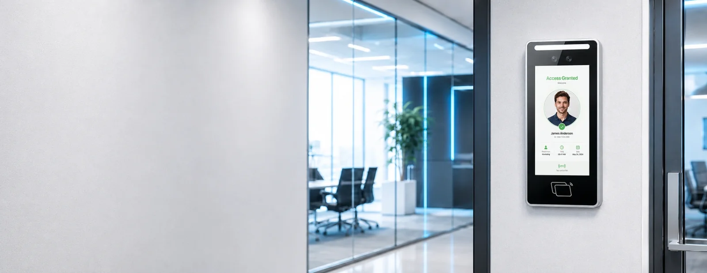
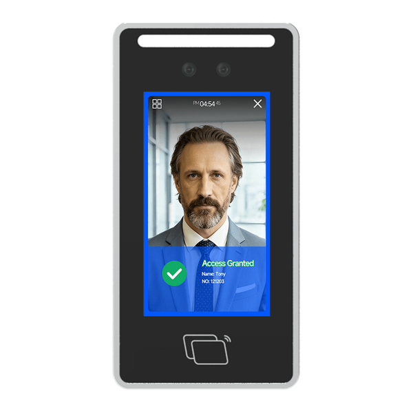
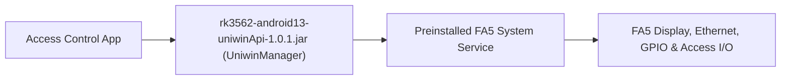

<div align="center">
  <a href="https://www.suntekai.com">
    <picture>
      <source media="(prefers-color-scheme: dark)" srcset="./assets/logo-dark.png">
      <source media="(prefers-color-scheme: light)" srcset="./assets/logo-light.png">
      
    </picture>
  </a>

  <h1>SUNTEK FA5 Biometric Access Terminal SDK</h1>

  <p>
    <strong>Official Hardware SDK &amp; Developer Kit</strong> &middot; <em>Enjoy Smarter Service</em><br>
    Official Android 13 system, GPIO, relay, RS485, Wiegand, and <code>M352-V</code> motherboard control SDK (<code>sdk/rk3562-android13-uniwinApi-1.0.1.jar</code> / <code>UniwinManager</code>) for <strong>SUNTEK FA5</strong> terminals (<strong>SUNTEK Technology Co., Ltd.</strong>).
  </p>

  <p>
    <a href="./LICENSE"></a>
    <a href="https://github.com/SUNTEK-Official/suntek-sdk-fa5/releases"></a>
    
    <a href="https://www.suntekai.com/products/face-recognition-access-control-fa5/"></a>
    <a href="mailto:support@suntekai.com"></a>
  </p>

  <p>
    <a href="#hardware-showcase--compatibility">Hardware</a> &nbsp;&bull;&nbsp;
    <a href="#architecture--key-capabilities">Architecture</a> &nbsp;&bull;&nbsp;
    <a href="#supported-interfaces--physical-connections">Interfaces</a> &nbsp;&bull;&nbsp;
    <a href="#5-minute-quick-start">Quick Start</a> &nbsp;&bull;&nbsp;
    <a href="#sample-apps--prebuilt-downloads">Downloads</a> &nbsp;&bull;&nbsp;
    <a href="#troubleshooting--faq">FAQ</a> &nbsp;&bull;&nbsp;
    <a href="#documentation-changelog--support">Support</a>
  </p>
  
</div>

---

## Hardware Showcase & Compatibility

<table>
  <tr>
    <td align="center" width="38%">
      <a href="https://www.suntekai.com/products/face-recognition-access-control-fa5/">
        
      </a>
      <br>
      <strong>FA5</strong><br>
      <sub>AI Face Recognition Access Control Terminal</sub><br>
      <a href="https://www.suntekai.com/products/face-recognition-access-control-fa5/">Official Product Page</a>
    </td>
    <td valign="top" width="62%">
      <ul>
        <li><strong>Platform</strong>: Rockchip RK3562 &middot; Android 13 (<code>M352-V</code> Motherboard)</li>
        <li><strong>SDK Library</strong>: Includes real <code>rk3562-android13-uniwinApi-1.0.1.jar</code> (<code>UniwinManager</code>)</li>
        <li><strong>System &amp; Display Control</strong>: Ethernet IP, nav/status bar visibility, silent app install &amp; power control</li>
        <li><strong>Privacy Compliance</strong>: 100% On-Device biometric processing (GDPR / BIPA ready)</li>
      </ul>
    </td>
  </tr>
</table>

| Product Model | Chipset / Board | OS Versions | Build Identifier | Status |
| :--- | :--- | :--- | :--- | :---: |
| **FA5** | Rockchip RK3562 (`M352-V`) | Android 13 | `FA5*` | Supported |

> [!IMPORTANT]
> Verify your device **Model** and **Build Number** under Android **Settings -> About device** before integration. Customer applications use your own Google Play or enterprise release certificate.

---

## Architecture & Key Capabilities

- **Complete FA5 System & Ethernet Control**: `UniwinManager` APIs for firmware version, serial number, Ethernet config, display orientation, and UI bar visibility.
- **M352-V Motherboard Peripherals**: Detailed pinout & GPIO peripheral guide (`docs/fa5-m352v-motherboard-guide.md`) plus full English API PDF (`docs/FA5-API-Documentation-EN.pdf`).
- **Pre-Linked Buildable Sample**: `sample-android/` bundles `rk3562-android13-uniwinApi-1.0.1.jar` and calls real `UniwinManager` methods directly.



---

## Supported Interfaces & Physical Connections

| Hardware Feature | Interface Type | Device Path / Service Target | Notes |
| :--- | :--- | :--- | :--- |
| **FA5 System SDK JAR** | Java API (`com.uniwin.system.manager.UniwinManager`) | `sdk/rk3562-android13-uniwinApi-1.0.1.jar` | Matches factory ROM AIDL service `com.uniwin.system.app.IUniwinManager` |
| **Motherboard Hardware Manual** | GPIO & Connector Pinout | `docs/FA5-API-Documentation-EN.pdf & fa5-m352v-motherboard-guide.md` | Complete M352-V connector and GPIO notes |

---

## Repository Directory Layout

```text
suntek-sdk-fa5/
├── assets/                 # Official SUNTEK logos, hero banner & FA5 product cutout
├── sdk/
│   └── rk3562-android13-uniwinApi-1.0.1.jar
├── docs/
│   ├── FA5-API-Documentation-EN.pdf
│   └── fa5-m352v-motherboard-guide.md
├── sample-android/         # Android Studio sample project (com.suntek.sample.fa5)
├── README.md
├── LICENSE
├── THIRD_PARTY_NOTICES.md
└── CHANGELOG.md
```

> All installers (`.exe`), compiled sample APKs (`.apk`), and large binary packages (> 5 MB) are hosted on [**GitHub Releases**](https://github.com/SUNTEK-Official/suntek-sdk-fa5/releases) with `SHA256SUMS.txt`.

---

## Prerequisites & Permissions

- **Platform Target**: `minSdk 26` / `targetSdk 35`
- **App Signing Requirement**: Customer applications use your standard release key via preinstalled platform services or companion `SuntekBridgeService.apk`.
- **Required Permissions / Capabilities**: GPIO, Ethernet settings, and silent package installation permissions as needed.
> [!NOTE]
> **Biometric Data & Privacy Notice (GDPR / BIPA Compliance)**: Access control and biometric template evaluation occur locally on the FA5 device. **SUNTEK Technology Co., Ltd.** collects no external biometric telemetry.


---

## 5-Minute Quick Start

### Step 1: Add JAR Dependency

```gradle
dependencies {
    implementation files('libs/rk3562-android13-uniwinApi-1.0.1.jar')
}
```

### Step 2: Query Terminal Model, Serial Number & UI Bars

```java
import com.uniwin.system.manager.UniwinManager;

UniwinManager manager = UniwinManager.getInstance(context);
String serial = manager.getSerialNumber();
String fw = manager.getFirmwareVersion();
manager.hideNavBar();
```

### Build & Run Sample Project

```bash
cd sample-android && ./gradlew assembleDebug
```

---

## Sample Apps & Prebuilt Downloads

Verified prebuilt APKs, offline SDK bundles, and checksum manifests are published on [**GitHub Releases**](https://github.com/SUNTEK-Official/suntek-sdk-fa5/releases). Verify downloaded archives before production deployment:

```bash
shasum -a 256 -c SHA256SUMS.txt
```

---

## Troubleshooting & FAQ

<details>
<summary><b>Where is `rk3562-android13-uniwinApi-1.0.1.jar` located?</b></summary>
<p>Bundled directly in both `sdk/rk3562-android13-uniwinApi-1.0.1.jar` and `sample-android/app/libs/`.</p>
</details>

<details>
<summary><b>Where are the FA5 API manual and `M352-V` motherboard pinout?</b></summary>
<p>See `docs/FA5-API-Documentation-EN.pdf` and `docs/fa5-m352v-motherboard-guide.md`.</p>
</details>

---

## Documentation, Changelog & Support

- **Changelog**: [CHANGELOG.md](./CHANGELOG.md)
- **Developer Documentation Portal**: [suntek-docs](https://github.com/SUNTEK-Official/suntek-docs)
- **Technical Support**: [support@suntekai.com](mailto:support@suntekai.com)
- **Bug Reports**: [Open an Issue](https://github.com/SUNTEK-Official/.github/issues/new/choose)
- **Security Disclosures**: See [SECURITY.md](https://github.com/SUNTEK-Official/.github/blob/main/SECURITY.md) or email [support@suntekai.com](mailto:support@suntekai.com)

---

<div align="center">
  
  <br><br>
  <strong>SUNTEK Technology Co., Ltd.</strong> &mdash; <em>Smart Commercial Terminal Hardware Manufacturer Since 2010</em><br>
  <sub>80+ Export Countries &middot; 5,000,000+ Terminals Shipped &middot; 500+ ODM Projects &middot; ISO 9001 / ISO 14001 / ISO 27001 / CE / RoHS</sub><br>
  <sub><a href="https://www.suntekai.com">www.suntekai.com</a> &middot; Copyright &copy; 2026 SUNTEK Technology Co., Ltd. All rights reserved.</sub>
</div>
